# ⚡ Awesome Cloud Command-Line Interface (CLI) &amp; Terminal Ecosystem 🌐

> A curated collection of top **Cloud Command-Line Interface (CLI) Terminals**, **Browser-Based Shells**, **Cloud Development Environments (CDEs)**, and **Modern Open-Source Terminal Emulators**.

 

 

**Cloud Command-Line Interface (CLI) Terminals** and browser-based shell environments eliminate local workstation setup, provide zero-trust secure infrastructure access, and enable engineers to develop, debug, and manage cloud workloads from any browser or device. 🚀

---

## 📑 Table of Contents

- [📊 Sector Overview & Market Dynamics](#-sector-overview--market-dynamics)
- [☁️ SaaS & Hosted Cloud Terminal Platforms](#️-saas--hosted-cloud-terminal-platforms)
- [💻 Open-Source GitHub Projects](#-open-source-github-projects)
- [🎯 Key Selection Criteria](#-key-selection-criteria)
- [🤝 How to Contribute](#-how-to-contribute)
- [📈 Star History](#-star-history)
- [💖 Support & Sponsorship](#-support--sponsorship)
- [🛡️ Disclaimer & Security Considerations](#️-disclaimer--security-considerations)

---

## 📊 Sector Overview & Market Dynamics

The global market for cloud development environments, terminal access, and remote system administration tools is estimated at over **$9.5 billion**, expanding at a compound annual growth rate (**CAGR**) of **10.5%–13%** alongside the broader $900B+ public cloud infrastructure ecosystem. 📈

The sector exhibits a **bifurcated, moderately concentrated market dynamic**: 
- **Hyperscale Cloud Shells** (AWS, Microsoft Azure, Google Cloud) capture massive built-in platform usage in a near-concentrated distribution for provider-specific tasks.
- **Independent AI-Native Terminals & CDEs** (Warp, Replit, Gitpod, Termius) represent an active, highly competitive landscape with rapid feature evolution and open-source fragmentation.

---

## ☁️ SaaS & Hosted Cloud Terminal Platforms

The table below lists leading SaaS and managed cloud terminal solutions, sorted in descending order by company scale (market capitalization / enterprise valuation / annual revenue). 🏢

| Product | Scale (Valuation / Revenue) | Description | Pricing (Starting) | Free Tier / Trial Limits |
|:---|:---|:---|:---|:---|
| **[Azure Cloud Shell](https://azure.microsoft.com/en-us/products/cloud-shell/)** | ~$3.1T Market Cap (Microsoft) | Browser-based authenticating shell offering Bash and PowerShell with pre-installed Azure CLI and developer utilities. | $0 host compute (Underlying Azure Files storage charged at standard rates, ~$0.05–$0.20/month for standard 5 GB LRS) | **Free forever**: Free host VM compute instances; includes persistent 5 GB Azure file share storage (storage billed at standard Azure Files rates); 20-minute idle session timeout. |
| **[AWS CloudShell](https://aws.amazon.com/cloudshell/)** | ~$2.2T Market Cap (Amazon) | Pre-authenticated browser-based Linux shell integrated into the AWS Management Console with AWS CLI and SDKs. | $0 for compute (Standard AWS resource and outbound data transfer costs apply if provisioned) | **Free forever**: 1 GB persistent storage in `$HOME` per AWS region, up to 10 concurrent shell sessions per region; 120-day persistent storage retention after inactivity; 12-hour max session lifetime. |
| **[Google Cloud Shell](https://cloud.google.com/shell)** | ~$2.1T Market Cap (Alphabet) | Browser-based terminal with pre-configured gcloud CLI, built-in code editor, and language toolchains for GCP. | $0 (Pay only for downstream GCP cloud resources utilized) | **Free forever**: 5 GB persistent `$HOME` disk per user, 1-hour idle timeout, 12-hour maximum continuous session duration, 50 hours/week usage quota. |
| **[Replit](https://replit.com/)** | ~$9.0B Valuation (~$240M ARR) | AI-powered online software development platform and cloud workspace with full interactive shell access. | $20/month ($18/month billed annually) for Core plan | **Free forever Starter Plan**: Full browser IDE and interactive shell access, 1 workspace, community support, no credit card required, with basic compute and performance limits. |
| **[Zoho Terminal](https://www.zoho.com/)** | ~$1.2B Annual Revenue (Zoho Corp) | Terminal and developer console integrated within the Zoho Cloud suite and developer workspace for custom extensions. | $14/user/month (Billed annually for Zoho Creator Standard plan, or $20 billed monthly) | **15-day free trial**: Access to developer console and workspace environments for 1 user during the 15-day trial period; permanent free plan available on Zoho Creator with 1 app and 25MB storage. |
| **[Warp Terminal](https://www.warp.dev/)** | ~$500M Valuation (~$20M ARR) | Rust-based modern AI terminal with natural language command assistance, block-based output, and team collaboration. | $20/month ($18/month billed annually) for Build plan; $50/user/month ($45 billed annually) for Business | **Free forever**: Full core terminal functionality, local AI inference, Warp Agent CLI, 100 free cloud AI requests per month, and personal Warp Drive with up to 30 snippets. |
| **[Gitpod](https://www.gitpod.io/)** | ~$41M Funding (~$4M ARR) | Automated cloud development environment (CDE) and cloud terminal orchestrating isolated development containers. | $20/month for Gitpod Core | **Free forever Plan**: 5 concurrent cloud environments, unlimited local environments via Gitpod Desktop, up to 896 cores / 12 TB RAM cluster capacity allocation. |
| **[Termius](https://termius.com/)** | ~$2.7M Funding (~$4M ARR) | Cross-platform SSH client, SFTP terminal, and remote environment manager with end-to-end encrypted sync. | $12/month ($10/month billed annually) for Pro; $24/seat/month ($20 billed annually) for Team | **Free forever Starter Plan**: Full basic local vault, interactive SSH and SFTP terminal, port forwarding, terminal tabs/split view, and AI command autocomplete for single-device use. |
| **[Webminal](https://www.webminal.org/)** | Non-Profit / Community FLOSS ($0) | Free online GNU/Linux learning terminal and sandbox environment for practicing Linux commands and programming. | Free forever ($0, 100% community and donation-supported) | **Free forever**: Unlimited browser Bash shell sessions, built-in gcc/g++, Python, nano, and MySQL access upon free account registration. |

---

## 💻 Open-Source GitHub Projects

The following table highlights top open-source terminal emulators, browser-based shell components, and self-hosted cloud terminal servers, sorted in descending order by GitHub stargazers. ⭐

| Project | Stars_Badge | Description | Primary Language / Stack |
|:---|:---|:---|:---|
| **[VS Code](https://github.com/microsoft/vscode)** |  | Industry-standard open-source code editor featuring a full-featured integrated terminal with WebGL acceleration. | TypeScript / Electron 💻 |
| **[Alacritty](https://github.com/alacritty/alacritty)** |  | Fast, cross-platform, GPU-accelerated terminal emulator focused on simplicity and raw performance. | Rust / OpenGL 🦀 |
| **[Ghostty](https://github.com/ghostty-org/ghostty)** |  | Fast, feature-rich, GPU-accelerated cross-platform terminal emulator with native platform UI integrations. | Zig / Metal / OpenGL ⚡ |
| **[Hyper](https://github.com/vercel/hyper)** |  | Highly customizable, extensible terminal emulator built entirely on modern web technologies. | TypeScript / HTML / CSS 🌐 |
| **[Kitty](https://github.com/kovidgoyal/kitty)** |  | Cross-platform, fast, feature-rich, GPU-based terminal emulator supporting graphics protocols and scripting. | C / Python 🐱 |
| **[WezTerm](https://github.com/wez/wezterm)** |  | Powerful GPU-accelerated cross-platform terminal emulator and multiplexer configured via Lua. | Rust / Lua ⚙️ |
| **[xterm.js](https://github.com/xtermjs/xterm.js)** |  | Standard web terminal front-end component powering VS Code, Hyper, and major cloud shell environments. | TypeScript 📦 |
| **[Coder](https://github.com/coder/coder)** |  | Self-hosted cloud development environment (CDE) provisioner managing remote developer workspaces and shells. | Go / TypeScript ☁️ |
| **[ttyd](https://github.com/tsl0922/ttyd)** |  | Lightweight command-line tool for sharing any local CLI terminal over the web via WebSockets. | C / libuv / xterm.js 🔗 |
| **[Rio Terminal](https://github.com/raphamorim/rio)** |  | Hardware-accelerated, modern desktop terminal emulator designed for high concurrency and screen navigation. | Rust / WebGPU 🚀 |
| **[Wetty](https://github.com/butlerx/wetty)** |  | Terminal in browser over HTTP/HTTPS and SSH, built with Node.js and xterm.js. | TypeScript / Node.js 🌍 |
| **[WGLT](https://github.com/codyebberson/wglt)** |  | High-performance WebGL terminal renderer addon designed for xterm.js canvas rendering. | TypeScript / WebGL 🎨 |

---

## 🎯 Key Selection Criteria

When choosing a cloud terminal solution or terminal emulator for your infrastructure workflows, consider:

1. ⚡ **Rendering Performance**: For high-throughput command output, opt for GPU-accelerated terminal emulators ([Ghostty](https://github.com/ghostty-org/ghostty), [Alacritty](https://github.com/alacritty/alacritty), [Kitty](https://github.com/kovidgoyal/kitty)) or WebGL-accelerated web renderers ([xterm.js](https://github.com/xtermjs/xterm.js)).
2. 💾 **Persistence vs. Ephemeral Security**: Cloud providers offer persistent home directories (1 GB on AWS CloudShell, 5 GB on Azure & GCP), but ephemeral modes may be preferred for zero-footprint bastion access.
3. 🤖 **AI Assistance & Collaboration**: Next-generation CLIs like [Warp](https://www.warp.dev/) and [Replit](https://replit.com/) provide integrated conversational AI agents, error explanations, and shared command drives.
4. 🔒 **Self-Hosting & Privacy**: For self-hosted browser-based shells without third-party telemetry, deploy [Coder](https://github.com/coder/coder), [ttyd](https://github.com/tsl0922/ttyd), or [Wetty](https://github.com/butlerx/wetty) behind your own reverse proxy and VPN.

---

## 🤝 How to Contribute

Contributions are warmly encouraged! 🎉 To propose a new SaaS product or open-source terminal project:

1. 🍴 Fork this repository.
2. 🌿 Create a feature branch: `git checkout -b add-terminal-tool`
3. 📝 Add the project to `README.md` keeping the existing tabular formatting:
   - For **SaaS**: Include accurate starting tier pricing, explicit free tier / trial limits, and company scale metrics.
   - For **Open-Source**: Include the repository link, official stargazer badge ``, description, and stack. Sort by stargazers.
4. 🚀 Open a Pull Request with a clear description of the project.

---

##  Star History

---

## 💖 Support & Sponsorship

Thank you so much for exploring this curated guide! 🌟 If you found this repository useful, please consider:
- ⭐ **Starring** the repository to boost visibility.
- 🍴 **Forking** and contributing new tools or corrections.
- 📢 **Sharing** with fellow developers, DevOps engineers, and cloud architects.
- ☕ **Buying a coffee or sponsoring** future maintenance via the [GitHub Sponsor Dashboard](https://github.com/sponsors/ishandutta2007).

Your support keeps open-source projects thriving! 🙌

---

## 🛡️ Disclaimer & Security Considerations

- This list is **community-curated** for educational and architectural reference purposes.
- ⚠️ **Security Warning**: Browser-based terminals expose root or remote execution shells. Always implement strong authentication (SSO/MFA), network isolation (private VPCs/tunnels), and strict session timeouts when serving terminal endpoints over the web.

---

Built with ❤️ for developers, DevOps engineers, and cloud architects worldwide. Star ⭐ this repository if you find it helpful!

